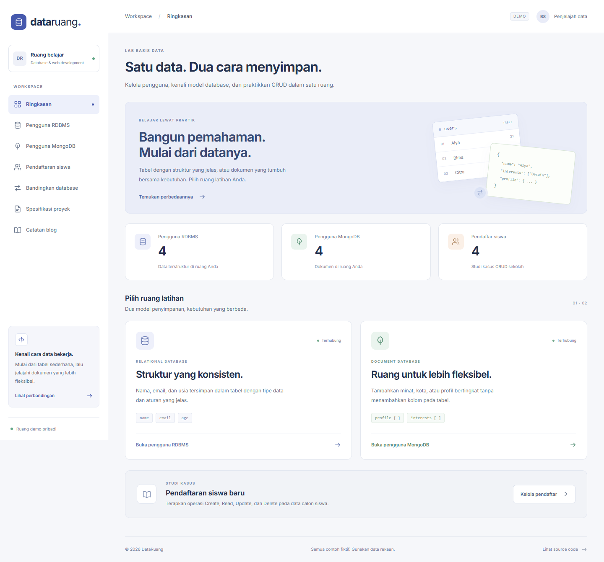
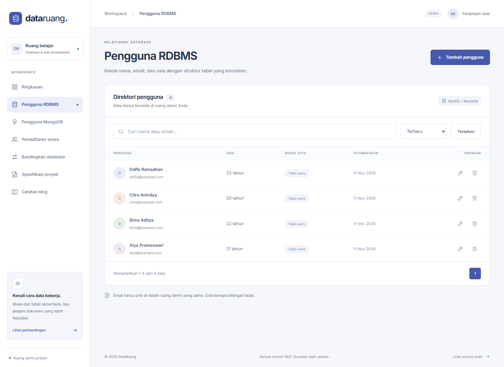
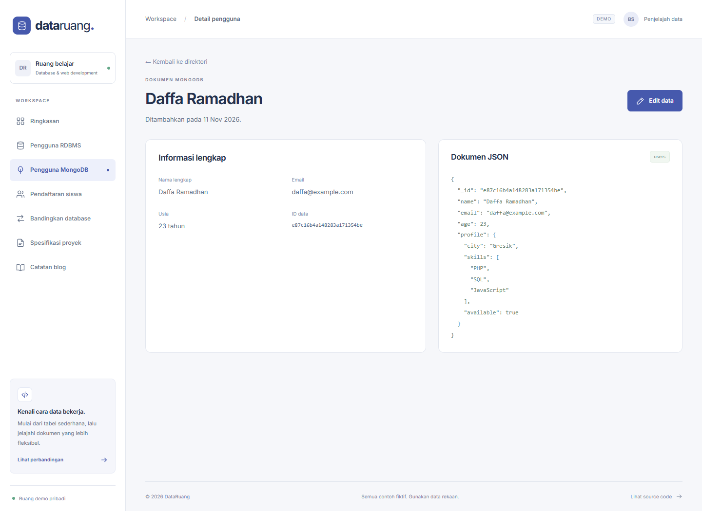
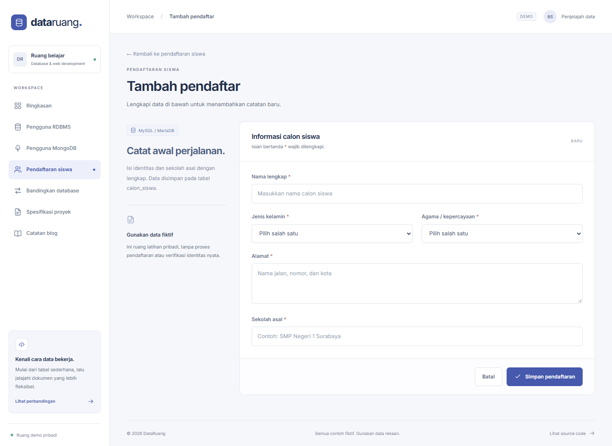
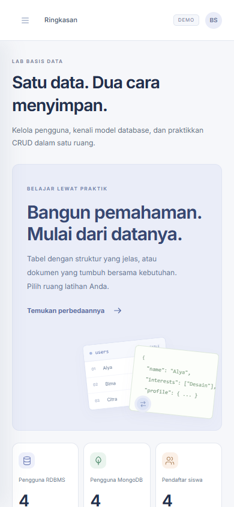

# Belajar MySQL dan MongoDB lewat DataRuang: CRUD Pengguna, Pendaftaran Siswa, dan Spesifikasi Proyek

Saya membuat **DataRuang**, aplikasi untuk mengelola data pengguna dan pendaftaran siswa sekaligus memahami perbedaan penyimpanan relasional dan dokumen.

Proyek ini terdiri dari empat bagian: aplikasi pengguna dengan RDBMS, aplikasi pengguna dengan MongoDB, CRUD pendaftaran siswa baru, serta spesifikasi proyek website. Semua bagian tersedia dalam satu repository, dengan halaman dan modul penyimpanan yang terpisah.

[Buka DataRuang](https://pweb-mysql.vercel.app) · [Source code PWEB-MySQL](https://github.com/Boyeep/PWEB-MySQL) · [Spesifikasi proyek](https://github.com/Boyeep/PWEB-MySQL/blob/main/docs/SPECIFICATION.md)

## 1. Memilih Database dari Kebutuhan Data

Pada modul pengguna RDBMS, data inti yang disimpan adalah **name, email, dan age**. Ketiganya dapat dimodelkan sebagai kolom dalam sebuah tabel. Nama dan email berupa teks, sedangkan usia berupa bilangan bulat. Struktur ini cocok untuk memperlihatkan cara kerja RDBMS.

Pada modul MongoDB, pengguna tetap memiliki data inti yang sama, tetapi profil tambahannya dapat berbeda. Satu pengguna mempunyai kota dan daftar minat, pengguna lain mempunyai pendidikan, keterampilan, atau tautan sosial. MongoDB menyimpan variasi tersebut sebagai bagian dari dokumen.

Perbedaannya tidak berarti database relasional selalu kaku atau MongoDB tidak memiliki aturan. RDBMS dapat menyimpan JSON, dan MongoDB dapat menerapkan validasi skema maupun transaksi. Pilihan akhirnya bergantung pada relasi, pola akses, kebutuhan integritas, dan cara data berkembang.



## 2. Teknologi dan Struktur Aplikasi

Backend proyek ini menggunakan **Node.js**. Saya memilihnya agar driver MySQL dan driver resmi MongoDB dapat digunakan dalam satu aplikasi. HTML dirender di server; CSS dan font disimpan lokal. JavaScript pada browser hanya membantu tombol navigasi pada ponsel, sehingga proses CRUD tidak bergantung pada JavaScript browser.

```text
PWEB-MySQL/
├── api/index.mjs           # Entry point hosting Vercel
├── src/
│   ├── app.mjs             # Routing, cookie, CSRF, request/response
│   ├── sql-store.mjs       # Query MySQL dan adapter PostgreSQL
│   ├── mongo-store.mjs     # Operasi collection MongoDB
│   ├── validation.mjs      # Pemeriksaan input di server
│   ├── views.mjs           # HTML halaman dan komponen bersama
│   └── data.mjs            # Data awal fiktif
├── public/assets/          # CSS, JavaScript, SVG, dan font lokal
├── database/mysql.sql
├── docs/
├── tests/
└── server.mjs              # Server lokal
```

Halaman `/rdbms` mengelola pengguna relasional, `/mongodb` mengelola dokumen pengguna, dan `/siswa` mengelola calon siswa. Ada pula halaman perbandingan, spesifikasi proyek, dan artikel ini. Pemisahan modul database membantu saya melihat bagian mana yang berbeda ketika model penyimpanannya berubah.

## 3. Membuat Tabel Users di MySQL

Saya menyiapkan database `pweb_mysql_lab` dan tabel `users`. Selain tiga kolom inti, saya menambahkan ID, waktu pembuatan, serta `workspace_id` untuk membedakan ruang demo pengunjung. ID dibuat di server. Email harus unik di dalam ruang demo yang sama.

```sql
CREATE TABLE users (
  id VARCHAR(36) PRIMARY KEY,
  workspace_id CHAR(32) NOT NULL,
  name VARCHAR(100) NOT NULL,
  email VARCHAR(254) NOT NULL,
  age SMALLINT NOT NULL CHECK (age BETWEEN 1 AND 120),
  created_at VARCHAR(30) NOT NULL,
  CONSTRAINT users_email_unique UNIQUE (workspace_id,email),
  CONSTRAINT users_workspace_fk
    FOREIGN KEY (workspace_id) REFERENCES workspaces(id)
    ON DELETE CASCADE
) ENGINE=InnoDB;
```

`PRIMARY KEY` memberikan identitas unik setiap catatan. `NOT NULL` memastikan kolom wajib tidak bernilai NULL. `UNIQUE` menolak email berulang untuk ruang yang sama, sedangkan `CHECK` membatasi rentang usia. Foreign key menghubungkan data pengguna dengan tabel ruang demo.

Validasi juga dilakukan pada aplikasi. Misalnya, teks kosong tidak otomatis ditolak oleh NOT NULL, sehingga panjang nama tetap diperiksa sebelum query dijalankan.



## 4. Menjalankan CRUD dengan Query Berparameter

Create menggunakan INSERT, Read menggunakan SELECT, Update menggunakan UPDATE, dan Delete menggunakan DELETE. Nilai dari formulir dikirim terpisah melalui parameter, bukan digabungkan ke teks SQL.

Berikut bentuk dasar operasi update dengan `mysql2`:

```js
await connection.execute(
  'UPDATE users SET name=?, email=?, age=? WHERE workspace_id=? AND id=?',
  [data.name, data.email, data.age, workspaceId, userId]
);
```

Kondisi `workspace_id` diterapkan pada pembacaan, perubahan, dan penghapusan. Mengganti ID pada URL tidak memberikan akses ke ruang demo lain. Nama tabel dan kolom dipilih dari daftar yang ditentukan kode, bukan dari nilai bebas yang dikirim pengguna.

Direktori menyediakan pencarian nama atau email, pengurutan, paginasi delapan baris, detail, edit, dan konfirmasi hapus. GET pada halaman hapus hanya menampilkan konfirmasi; penghapusan sebenarnya memakai POST dan token CSRF.

## 5. Menyimpan Profil Fleksibel di MongoDB

MongoDB menggunakan collection `users`. Dokumen memiliki data inti yang sama dengan versi RDBMS, lalu menambahkan objek `profile`. Berikut ilustrasi bentuk dokumennya:

```json
{
  "name": "Alya Prameswari",
  "email": "alya@example.com",
  "age": 21,
  "profile": {
    "city": "Surabaya",
    "interests": ["Desain", "Fotografi"],
    "social": {
      "github": "alya-demo"
    }
  }
}
```

Pengguna lain boleh memiliki properti profil yang berbeda. Formulir menyediakan textarea JSON untuk mencoba objek, array, boolean, dan data bertingkat. Halaman detail memperlihatkan dokumen JSON agar perbedaannya dengan tabel lebih mudah dipahami.

```js
await db.collection('users').updateOne(
  { _id: new ObjectId(userId), workspaceId },
  { $set: {
      name: data.name,
      email: data.email,
      age: data.age,
      profile: data.profile
  } }
);
```

Filter tetap dibentuk oleh server. Input pengguna tidak dapat langsung menjadi operator pencarian. Aplikasi memeriksa format ObjectId dan membatasi ukuran serta kedalaman JSON profil. Nama properti yang dapat dipakai sebagai operator atau menyebabkan perubahan prototype ditolak. Unique index pada pasangan workspace dan email menjaga agar email tidak berulang di ruang yang sama.



## 6. Studi Kasus Pendaftaran Siswa Baru

Bagian pendaftaran siswa menggunakan tabel `calon_siswa`. Isian utamanya adalah nama, alamat, jenis kelamin, agama atau kepercayaan, serta sekolah asal. Saya memisahkan data calon siswa ke tabel tersendiri dan membuat antarmukanya konsisten dengan direktori pengguna.

Pengguna dapat menambahkan pendaftar, mencari nama atau sekolah, membuka detail, mengedit, serta menghapus setelah konfirmasi. Form yang gagal validasi mempertahankan isian sebelumnya dan menampilkan penjelasan di dekat kolom terkait.



SMK Cakrawala, nama, email, dan alamat contoh merupakan ilustrasi. Aplikasi mencatat data pendaftaran untuk latihan; aplikasi tidak menjalankan seleksi atau menetapkan kelulusan siswa.

## 7. Mengamankan Alur Formulir

Beberapa aturan yang saya terapkan pada proyek ini:

- Nama, email, usia, pilihan form, dan JSON diperiksa kembali di server.
- Cookie ruang demo ditandatangani dengan HMAC agar ID ruang tidak dapat diubah tanpa tanda tangan yang sesuai.
- Token CSRF harus cocok sebelum operasi tambah, edit, atau hapus dijalankan.
- Query SQL memakai parameter, dan filter MongoDB dibentuk secara eksplisit.
- Teks di-escape saat dimasukkan ke HTML agar input yang menyerupai tag tidak dijalankan browser.
- Email diperiksa keunikannya oleh database, bukan hanya pemeriksaan pada form.
- Setiap query dibatasi ke ruang demo yang sedang aktif.

Cookie ruang demo ini tidak sama dengan akun petugas. Sistem autentikasi akun dan otorisasi per peran dijelaskan sebagai pengembangan berikutnya pada dokumen spesifikasi.

## 8. Menyusun Spesifikasi Front End dan Back End

Untuk bagian perencanaan proyek, saya membuat spesifikasi **Cakrawala PPDB**. Dokumen menjelaskan nama, deskripsi, tujuan, pengguna, fitur, pengelolaan data, logika bisnis, autentikasi dan keamanan, API, rencana implementasi, serta kriteria penerimaan.

Rencana front end meliputi halaman informasi, login, form pendaftaran, berkas, dashboard calon siswa, dan dashboard petugas. Rencana back end meliputi hubungan tabel, aturan periode pendaftaran, status draft dan verifikasi, serta histori perubahan.

Integrasi payment gateway hanya dibahas sebagai rencana sandbox apabila sekolah memerlukannya. Status pembayaran tidak boleh ditentukan dari redirect browser saja. Server perlu memverifikasi notifikasi gateway, nominal, identitas order, dan event berulang. Demo tidak menerima pembayaran nyata.

Dokumen membedakan fitur prototipe yang sudah dibuat dengan fitur sistem sekolah yang masih direncanakan. [Baca spesifikasi lengkap](https://github.com/Boyeep/PWEB-MySQL/blob/main/docs/SPECIFICATION.md).

## 9. Menjalankan, Menguji, dan Menyiapkan Hosting

```sh
git clone https://github.com/Boyeep/PWEB-MySQL.git
cd PWEB-MySQL
npm ci
```

Setelah itu, impor `database/mysql.sql`, salin `.env.example` menjadi `.env`, lalu sesuaikan koneksi MySQL dan MongoDB. Isi `APP_SECRET` dengan nilai acak dan jalankan `npm start`. Kredensial hanya disimpan di environment dan tidak ikut masuk GitHub.

Pengujian lokal menggunakan MySQL/MariaDB dan MongoDB asli. MongoDB sementara untuk QA dijalankan melalui `mongodb-memory-server`, yang menyalakan binary server MongoDB, bukan mengganti database dengan mock. Suite pemeriksaan mencakup CRUD, validasi, email duplikat, CSRF, pemisahan workspace, profil JSON, pencarian, dan penghapusan yang bertahan pada request berikutnya.

Pada hosting serverless, layanan database perlu dapat dijangkau melalui jaringan. Database yang hanya berjalan di laptop tidak otomatis tersedia di Vercel. Proyek menyediakan konfigurasi MySQL dan MongoDB melalui environment, serta adapter PostgreSQL untuk pilihan RDBMS hosting lain. Nama engine ditampilkan sesuai koneksi yang benar-benar digunakan; PostgreSQL tidak diberi label MySQL.



Layout menyesuaikan layar kecil: navigasi memakai tombol menu, formulir menjadi satu kolom, dan tabel dapat digeser tanpa membuat seluruh halaman melebar. Source code, hasil pengujian, screenshot, dan artikel tersedia pada [repository PWEB-MySQL](https://github.com/Boyeep/PWEB-MySQL).

## Dokumentasi Teknologi

- [MySQL 8.4 Reference Manual: CREATE TABLE](https://dev.mysql.com/doc/refman/8.4/en/create-table.html)
- [MongoDB Node.js Driver: Insert Documents](https://www.mongodb.com/docs/drivers/node/current/crud/insert/)
- [MySQL2: Prepared Statements](https://sidorares.github.io/node-mysql2/docs/documentation/prepared-statements)
